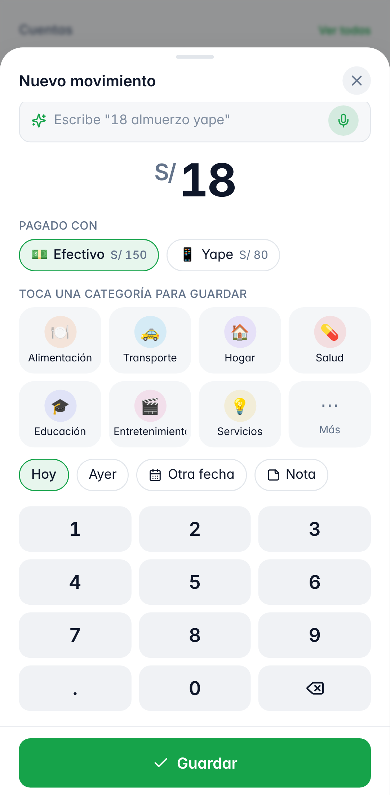
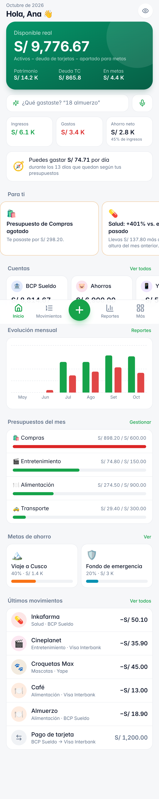
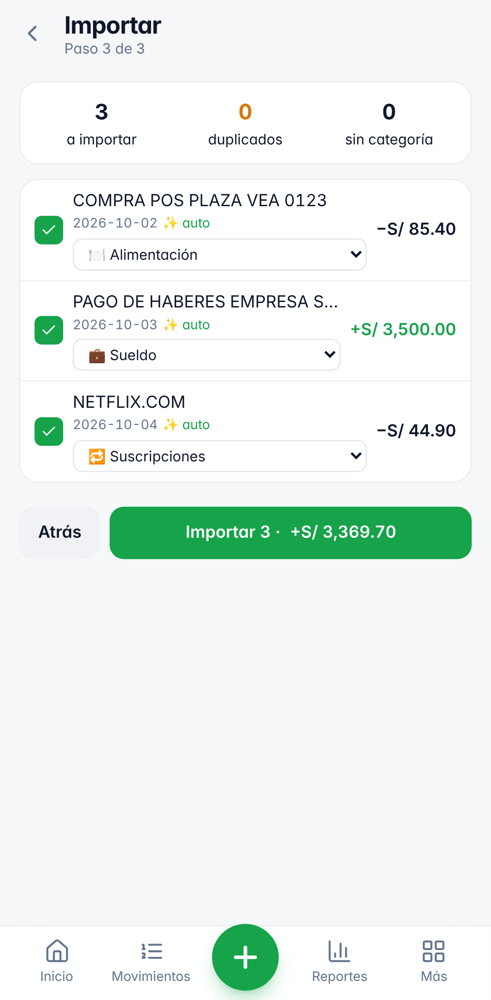
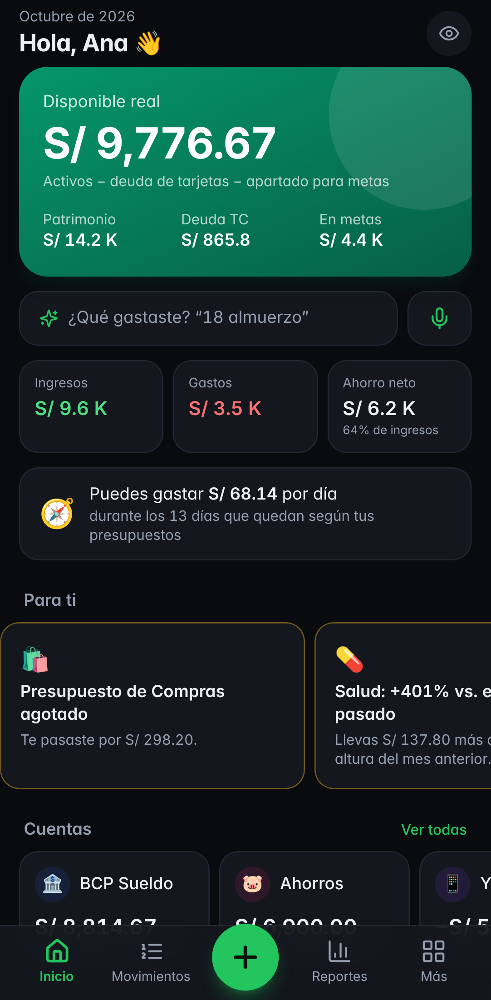

# Plata · finanzas personales en segundos

> Captura tus finanzas en segundos y obtén claridad total de tu dinero sin hojas de cálculo ni procesos manuales.

PWA mobile-first (Next.js + TypeScript + Tailwind + Zustand + Recharts + Supabase) pensada para Perú: S/, Yape/Plin, bancos locales y voz en español.

## Qué hace
- **Registro en 3 toques:** `+` → monto → categoría (se guarda al tocarla). Cuenta recordada, deshacer en el toast.
- **Texto y voz:** “Gasté 18 soles en almuerzo”, “ayer 25 taxi con yape”, “me pagaron 2,500 de sueldo”, “pagué la tarjeta 800 desde bcp”. Mantén presionado `+` para dictar.
- **Disponible real:** activos − deuda de tarjetas − dinero apartado para metas, y cuánto puedes gastar por día.
- Cuentas (banco, ahorros, tarjeta, wallet, efectivo), transferencias y pagos de tarjeta, metas con aportes, presupuestos con alertas 50/80/100 %, reportes (categorías, tendencias, ingresos vs gastos, flujo de caja, patrimonio).
- **Importación de CSV** del banco o de Notion: detecta columnas, categoriza, marca duplicados y aprende de tus correcciones.
- **Offline-first:** todo funciona sin conexión y sin cuenta; Supabase añade respaldo y sincronización.

## Empezar

```bash
cd finanzas
npm install
npm run dev          # http://localhost:3000
npm test             # tests de dominio (parser, saldos, presupuestos, importación)
npm run build
```

Sin variables de entorno la app funciona en **modo local** (IndexedDB). Para sincronizar:

1. Crea un proyecto en [Supabase](https://supabase.com) y ejecuta `supabase/migrations/0001_init.sql` y `0002_rls.sql` (SQL editor o `supabase db push`).
2. En *Authentication → URL configuration* añade tu dominio a las URLs de redirección.
3. Copia `.env.example` a `.env.local` y completa `NEXT_PUBLIC_SUPABASE_URL` y `NEXT_PUBLIC_SUPABASE_ANON_KEY`.
4. Despliega en Vercel con *Root Directory* = `finanzas`.

En el celular: abre la URL → menú del navegador → **Agregar a pantalla de inicio**. Mantén presionado el ícono para los atajos *Nuevo gasto / Dictar / Ingreso*.

## Documentación
1. [Producto: investigación, usuarios, decisiones, riesgos, innovación](docs/01-producto.md)
2. [Arquitectura, carpetas, APIs y seguridad](docs/02-arquitectura.md)
3. [Modelo de datos y diagrama ER](docs/03-datos.md)
4. [UX: navegación, wireframes y diseño móvil](docs/04-ux.md)
5. [Roadmap MVP/V2, historias de usuario y plan de implementación](docs/05-roadmap.md)

## Capturas
| Registro rápido | Inicio | Importar | Modo oscuro |
|---|---|---|---|
|  |  |  |  |
