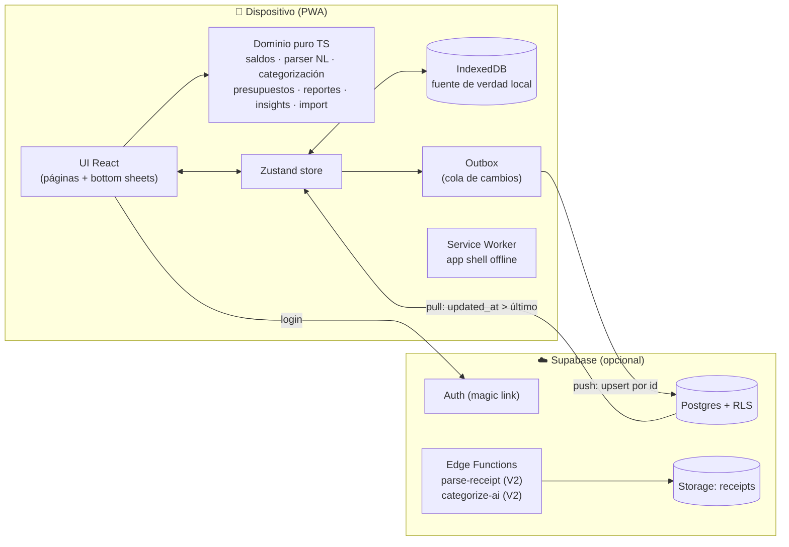

# 2. Arquitectura, carpetas, APIs y seguridad

## 2.1 Decisión de stack

| Capa | Elección | Justificación |
|---|---|---|
| Frontend | **Next.js 14 (App Router) + React 18 + TypeScript** | Rutas por archivo, build optimizado, despliegue gratuito en Vercel; tipado estricto para lógica financiera |
| Estilos | **Tailwind CSS** con tokens CSS (modo claro/oscuro) | Velocidad de desarrollo, bundle pequeño, tema por variables |
| Móvil | **PWA** (manifest + service worker + IndexedDB) | Un solo código; instalable; offline; atajos; *share target*. React Native solo si V3 necesita APIs nativas |
| Estado / datos locales | **Zustand + persist en IndexedDB** | Sencillo, sin boilerplate; IndexedDB soporta años de datos |
| Backend | **Supabase** (Postgres + Auth + Storage + Edge Functions) | BaaS con plan gratuito, SQL real, RLS, sin servidores que mantener |
| Auth | **Supabase Auth** (enlace mágico por correo) | Sin contraseñas que olvidar |
| Gráficos | **Recharts** | Declarativo, responsive, suficiente para finanzas personales |
| CSV | **PapaParse** | Robusto (delimitadores, comillas, codificaciones, streaming) |
| Tests | **Vitest** | Rápido; se prueba la lógica de dominio pura |

**Costo estimado:** 0 USD/mes para uso individual (Vercel Hobby + Supabase Free).

## 2.2 Arquitectura general



### Capas del cliente
1. **`lib/domain`** — funciones puras sin React ni I/O. Toda la lógica financiera vive aquí y está cubierta por tests.
2. **`lib/store`** — estado + acciones (mutaciones con sello `updatedAt` y encolado en outbox) + selectores memoizados.
3. **`lib/sync`** — motor de sincronización (push/pull, mapeo camelCase↔snake_case).
4. **`lib/import`** — detección de columnas y armado de filas de importación.
5. **`components` / `app`** — presentación.

### Sincronización offline-first
- Cada fila tiene `id` (uuid generado en el cliente), `createdAt`, `updatedAt`, `deletedAt`.
- Toda mutación encola `{colección, id}` en el **outbox** (deduplicado).
- `syncNow()` se ejecuta al abrir la app, al volver a primer plano, al recuperar conexión y 1,5 s después de cada cambio.
  1. **Pull** de filas remotas con `updated_at > lastPulledAt − 2 min` → fusión *last-write-wins*.
  2. **Push** del outbox en orden de dependencias (cuentas → categorías → metas → presupuestos → movimientos → …) con `upsert` idempotente.
- Categorías predeterminadas creadas en dos dispositivos se **unifican por `key`** reescribiendo referencias.
- Eliminaciones = bajas lógicas → se propagan.

## 2.3 Estructura de carpetas

```
finanzas/
├── docs/                         # Esta documentación
├── public/
│   ├── manifest.webmanifest      # PWA: íconos, atajos, share_target
│   ├── sw.js                     # Service worker (offline)
│   └── icon.svg
├── supabase/
│   ├── migrations/
│   │   ├── 0001_init.sql         # Tablas, índices, vista de saldos, trigger de perfil
│   │   └── 0002_rls.sql          # RLS + verificación de pertenencia + bucket privado
│   └── functions/parse-receipt/  # Edge Function OCR (contrato V2)
├── src/
│   ├── app/                      # Rutas (App Router)
│   │   ├── layout.tsx            # Shell, metadata PWA
│   │   ├── page.tsx              # Dashboard
│   │   ├── movimientos/ reportes/ cuentas/ metas/
│   │   ├── presupuestos/ categorias/ importar/ ajustes/ mas/
│   │   └── icons/[size]/route.tsx  # Íconos PNG generados
│   ├── components/
│   │   ├── layout/               # AppShell, BottomNav, Toaster
│   │   ├── quick-add/            # QuickAdd (registro rápido), useSpeech
│   │   ├── dashboard/            # Onboarding
│   │   ├── charts/               # Recharts + tokens de tema
│   │   ├── tx/                   # TxRow
│   │   └── ui/                   # Sheet, Money, MoneyInput, bits
│   └── lib/
│       ├── domain/               # types, money, dates, balances, budgets, reports,
│       │                         # insights, text, categorize, parse, defaults (+ tests)
│       ├── import/               # detect (+ tests)
│       ├── store/                # store, selectors, ui, demo, idb-storage
│       └── sync/                 # supabase, engine
├── .env.example
└── package.json
```

## 2.4 Definición de APIs

La app usa la **API REST autogenerada de Supabase (PostgREST)** protegida por RLS; no hay backend propio que mantener. Todas las rutas requieren `Authorization: Bearer <JWT>` y `apikey: <anon>`.

### Recursos (tabla → endpoint `/rest/v1/<tabla>`)

| Recurso | Endpoint | Operaciones usadas |
|---|---|---|
| Cuentas | `/accounts` | `GET ?user_id=eq.{uid}&updated_at=gt.{ts}` · `POST` upsert (`Prefer: resolution=merge-duplicates`) |
| Categorías | `/categories` | ídem |
| Movimientos | `/transactions` | ídem; filtros adicionales `date=gte.&date=lte.`, `account_id=eq.` |
| Presupuestos | `/budgets` | ídem |
| Alertas emitidas | `/budget_alerts` | ídem |
| Metas | `/goals` | ídem |
| Aportes | `/goal_contributions` | ídem |
| Reglas aprendidas | `/category_rules` | ídem |
| Saldos (vista) | `/account_balances` | `GET` (lectura, `security_invoker`) |
| Perfil | `/profiles` | `GET`, `PATCH` |

### Contratos de dominio (cliente)

```ts
// Registro rápido
addTransaction(input: NewTx): { tx: Transaction; notices: Notice[] }      // notices = alertas de presupuesto
updateTransaction(id, patch): { notices: Notice[] }                        // aprende si cambió la categoría
deleteTransaction(id) / restoreTransaction(id)                             // baja lógica + deshacer

// Intérprete de lenguaje natural (texto y voz)
parseEntry(text, { accounts, categories, rules, now? }): ParsedEntry
// → { type, amount, date, accountId, toAccountId, transferKind, categoryId, description, detected }

// Categorización
suggestCategory(text, kind, categories, rules): { categoryId, confidence, reason } | null
learnRule(rules, text, categoryId): { rules, changed }

// Importación
findHeaderRow(rows) · detectColumns(header, sample): ColumnMap
buildRows(rows, map, { categories, rules, existing }): { rows: ImportRow[]; skipped }

// Cálculos
accountBalances(accounts, txs, until?) · position(...) → { assets, debt, netWorth, reserved, available }
budgetStatus(budget, txs, period) · pendingAlert(status, period, sent)
monthTotals · monthlySeries · spendingByCategory · dailyCashflow · netWorthSeries
buildInsights({...}): Insight[]
```

### Edge Functions (V2)

| Función | Método | Entrada | Salida |
|---|---|---|---|
| `parse-receipt` | POST | `{ path }` (imagen en bucket `receipts`) | `{ amount, merchant, date, categoryKey, confidence }` |
| `categorize-ai` | POST | `{ items: [{ id, text, kind }] }` | `{ results: [{ id, categoryKey, confidence }] }` |
| `inbound-email` | POST (webhook) | correo de consumo del banco | crea movimiento “por confirmar” |
| `weekly-digest` | cron | — | resumen por correo/WhatsApp |

## 2.5 Esquema de seguridad

| Amenaza | Control |
|---|---|
| Acceso a datos de otro usuario | **RLS forzada** en todas las tablas (`user_id = auth.uid()` en select/insert/update/delete) |
| Referenciar recursos ajenos adivinando uuids | Trigger `assert_same_owner` valida que cuenta/categoría/meta/presupuesto pertenezcan al mismo usuario |
| Exposición de la `anon key` | Es pública por diseño; sin RLS no da acceso a nada |
| `service_role` key | Nunca en el cliente; solo en Edge Functions como secreto |
| Credenciales bancarias | **No se piden ni almacenan.** Importación por archivo procesado en el dispositivo |
| Robo de sesión | JWT de corta duración con refresh; enlace mágico (sin contraseñas reutilizadas) |
| Comprobantes (V2) | Bucket **privado** `receipts`, ruta `{uid}/…`, política por carpeta; URLs firmadas temporales |
| XSS | React escapa por defecto; no se usa `dangerouslySetInnerHTML`; cabeceras `X-Content-Type-Options`, `X-Frame-Options: DENY`, `Referrer-Policy`, `Permissions-Policy` |
| Datos en reposo en el dispositivo | IndexedDB aislado por origen; modo privacidad para ocultar montos; V2: bloqueo con passkey/WebAuthn |
| Integridad de montos | Enteros en céntimos, `check (amount > 0)`, forma de transferencias validada por constraint |
| Datos en reposo en la nube | Postgres de Supabase cifrado en reposo; TLS en tránsito |
| Privacidad / derechos ARCO (Ley 29733, Perú) | Exportación completa (JSON/CSV) y borrado total desde Ajustes; borrado en cascada al eliminar la cuenta de Auth |
| IA (V2) | Enviar solo descripción del comercio (sin montos ni cuentas) al proveedor; respuesta validada por esquema |
