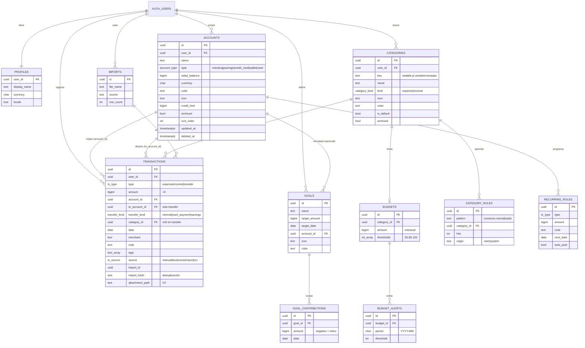

# 3. Modelo de datos y diagrama ER

## 3.1 Convenciones
- **Montos:** `bigint` en céntimos. `amount` siempre positivo; el signo lo da `type`.
- **IDs:** `uuid` generados en el cliente (captura offline sin colisiones).
- **Sincronización:** `created_at`, `updated_at` (LWW), `deleted_at` (baja lógica).
- **Saldos:** **derivados** (`initial_balance` + movimientos). Nunca se guardan. Vista `account_balances`.
- **Tarjetas de crédito:** saldo ≤ 0 representa deuda. Un consumo con tarjeta resta; el pago de tarjeta es una transferencia que suma.
- **Fechas:** `date` calendario local del usuario (sin zona), `timestamptz` para auditoría.

## 3.2 Diagrama ER



## 3.3 Reglas de negocio en la base
- `transfer_shape`: una transferencia tiene destino distinto del origen y no tiene categoría; un gasto/ingreso no tiene destino.
- `categories_user_key_uq`: una sola categoría predeterminada por `key` y usuario.
- `budget_alerts (budget_id, period, threshold)` único: cada aviso se emite una vez por mes.
- `on delete restrict` en cuentas referenciadas: una cuenta con historial se **archiva**, no se borra.

## 3.4 Fórmulas clave

```
saldo(cuenta) = initial_balance
              + Σ ingresos(cuenta) − Σ gastos(cuenta)
              − Σ transferencias salientes + Σ transferencias entrantes

activos       = Σ saldo(cuentas no-tarjeta)
deuda         = Σ max(0, −saldo(tarjetas))
patrimonio    = activos − deuda
apartado      = Σ max(0, Σ aportes(meta))      (metas activas)
disponible    = patrimonio − apartado

ahorro neto (mes)     = ingresos − gastos      (transferencias excluidas)
tasa de ahorro        = ahorro neto / ingresos
proyección del mes    = gasto a la fecha / día actual × días del mes
gasto diario sugerido = presupuesto restante / días restantes
aporte mensual meta   = (objetivo − ahorrado) / meses restantes
```
