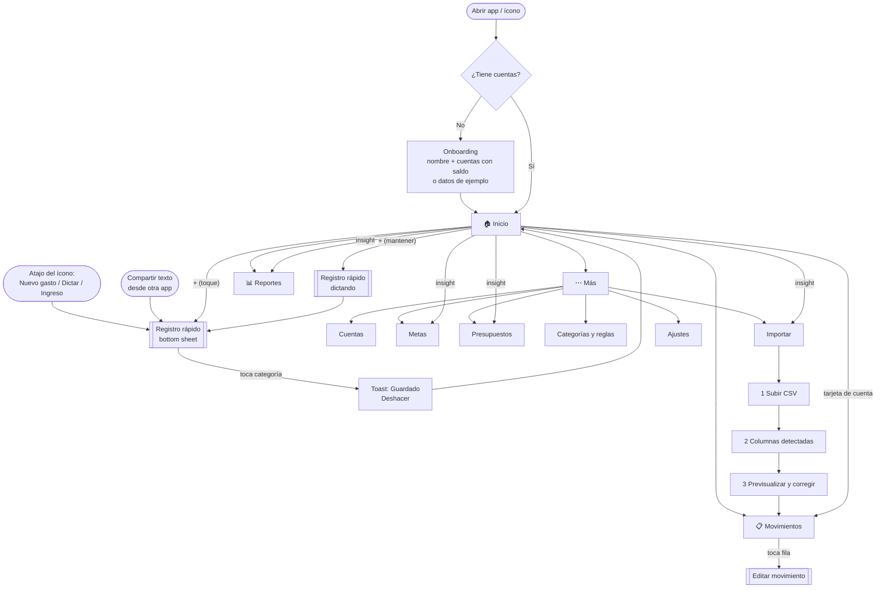

# 4. UX: navegación, wireframes y diseño móvil

## 4.1 Flujo de navegación



**Barra inferior (zona del pulgar):** Inicio · Movimientos · **[ + ]** · Reportes · Más. El botón `+` está siempre visible y centrado.

## 4.2 Wireframes en texto

### Inicio (Dashboard)
```
┌──────────────────────────────────────┐
│ Octubre 2026                    👁   │
│ Hola, Ana 👋                         │
│ ╔══════════════════════════════════╗ │
│ ║ Disponible real                  ║ │
│ ║ S/ 9,776.67                      ║ │
│ ║ Activos − deuda TC − metas       ║ │
│ ║ Patrimonio  Deuda TC   En metas  ║ │
│ ║ S/ 14.2K    S/ 865     S/ 4.4K   ║ │
│ ╚══════════════════════════════════╝ │
│ [✨ ¿Qué gastaste? "18 almuerzo"][🎙]│
│ ┌────────┐┌────────┐┌────────────┐   │
│ │Ingresos││ Gastos ││Ahorro neto │   │
│ │S/ 6.1K ││S/ 3.4K ││S/ 2.8K 45% │   │
│ └────────┘└────────┘└────────────┘   │
│ 🧭 Puedes gastar S/ 74.71 por día    │
│ Para ti  ◀ [⚠ Compras agotado] [..] ▶│
│ Cuentas  ◀ [🏦 BCP S/2.8K] [🐷 ..] ▶ │
│ Evolución mensual   ▂▅ ▃▆ ▄▅ ▆▇      │
│ Presupuestos  Compras ██████████ 299%│
│ Metas  [🏔 Cusco 40%] [🛡 Fondo 20%] │
│ Últimos movimientos                  │
│  💊 Inkafarma · Salud      −S/ 50.10 │
├──────────────────────────────────────┤
│  🏠    📋     ( + )     📊     ⋯     │
└──────────────────────────────────────┘
```

### Registro rápido (bottom sheet) — el corazón de la app
```
┌──────────────────────────────────────┐
│ Nuevo movimiento                  ✕  │
│ [ Gasto | Ingreso | Transferir ]     │
│ [✨ Escribe "18 almuerzo yape"  🎙 ] │
│                                      │
│              S/ 18                   │
│ PAGADO CON                           │
│ (💵 Efectivo S/150) (📱 Yape S/80) → │
│ TOCA UNA CATEGORÍA PARA GUARDAR      │
│ [🍽 Alim.][🚕 Transp][🏠 Hogar][💊]  │
│ [🎓 Edu. ][🎬 Entr. ][💡 Serv.][⋯ ]  │
│ (Hoy) (Ayer) (📅 Otra fecha) (📝 Nota)│
│ ┌─────┬─────┬─────┐                  │
│ │  1  │  2  │  3  │                  │
│ │  4  │  5  │  6  │                  │
│ │  7  │  8  │  9  │                  │
│ │  .  │  0  │  ⌫  │                  │
│ └─────┴─────┴─────┘                  │
│ [          ✓ Guardar           ]     │
└──────────────────────────────────────┘
Toques: (+) → 1 → 8 → [🍽] = guardado.
```

### Movimientos
```
│ Movimientos                          │
│   ‹     Octubre de 2026     ›        │
│ [Ingresos S/6.1K] [Gastos S/3.4K]    │
│ [🔍 Buscar comercio, nota, monto…  ] │
│ (Todos)(Gastos)(Ingresos)(Transf.)   │
│ Hoy                       −S/ 63.10  │
│  💊 Inkafarma · Salud · BCP −S/50.10 │
│  ☕ Café · Visa             −S/13.00 │
│ Ayer                      −S/ 54.80  │
```

### Reportes
```
│ [ Mes | 3M | 6M | 12M ]              │
│ Por categoría   [Gastos|Ingresos]    │
│        ◯ donut  Total S/ 3,352       │
│  🏠 Hogar  ███████░░  45% S/1,500    │
│ Ingresos vs gastos   ▅▃ ▅▄ ▆▄ ▆▃     │
│ Tendencia de gasto   ⟋‾‾ prom ---    │
│ Flujo de caja (día a día)  ‹ ›       │
│ Evolución patrimonial  ⟋⟋⟋           │
```

### Importar (3 pasos)
```
Paso 1: [ ⬆ Sube tu extracto o exportación de Notion ]
Paso 2: Fila de encabezados [Fila 2 ▾]
        Fecha [Fecha ▾]  Descripción [Descripción operación ▾]
        Cargo [Cargo ▾]  Abono [Abono ▾]  Cuenta destino [BCP ▾]
Paso 3: [3 a importar][0 duplicados][0 sin categoría]
        ☑ COMPRA POS PLAZA VEA   ✨auto [🍽 Alimentación ▾] −S/85.40
        ☑ PAGO DE HABERES        ✨auto [💼 Sueldo ▾]      +S/3,500
        [Atrás] [ Importar 3 · +S/3,369.70 ]
```

## 4.3 Diseño UX optimizado para móvil

| Principio | Aplicación |
|---|---|
| **Zona del pulgar** | Navegación y acción principal abajo; bottom sheets en lugar de pantallas nuevas; botones primarios a ancho completo al pie |
| **Objetivos táctiles ≥ 44 px** | Teclado de 48 px de alto, chips de 36 px, categorías de ~70 px |
| **Cero saltos de layout** | Teclado numérico propio; el monto siempre en la misma posición |
| **Feedback inmediato** | Animación de presión (`active:scale`), toast con *Deshacer*, vibración al mantener `+` |
| **Errores imposibles antes que mensajes** | No se puede guardar sin monto (el monto “tiembla”); transferencia exige cuentas distintas |
| **Jerarquía clara** | Una cifra héroe (Disponible real), luego resumen del mes, luego detalle |
| **Tipografía** | Fuente del sistema (SF/Roboto: carga 0 ms), cifras tabulares (`tnum`) para que los montos se alineen |
| **Color con significado** | Verde = ingreso/ok, rojo = gasto/excedido, ámbar = alerta 80 %; nunca solo color: siempre texto o % |
| **Emojis como íconos** | Reconocibles al instante, coloridos, sin peso de assets, personalizables |
| **Modo oscuro** automático | Tokens CSS por `prefers-color-scheme`; gráficos leen los mismos tokens |
| **Accesibilidad** | `aria-label` en botones de ícono, `role=dialog` en sheets, `aria-live` en toasts, `progressbar` con valores, respeta `prefers-reduced-motion` |
| **Privacidad** | Ojo en el header oculta todos los montos |
| **Áreas seguras** | `env(safe-area-inset-*)` para notch y barra de gestos |
| **Rendimiento** | Primera carga ~90–220 KB JS; todo calculado localmente (sin spinners tras abrir) |
