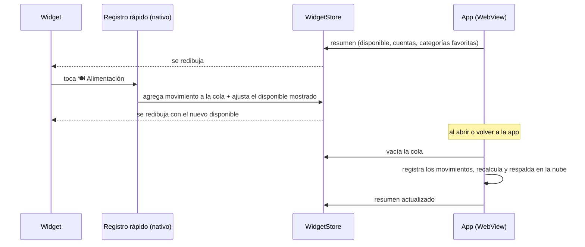

# 6. App Android, widget y almacenamiento de datos

## 6.1 Cómo está construida la app
- **Capacitor 6** empaqueta la interfaz (Next.js exportado a archivos estáticos) dentro de una app Android nativa. La app funciona sin internet: nada se descarga al abrirla.
- Código nativo propio (Java, en `android/app/src/main/java/pe/plata/finanzas/`):

| Archivo | Qué hace |
|---|---|
| `PlataWidgetProvider` | Dibuja el widget: disponible real, botón **+**, 4 categorías favoritas y **Dictar** |
| `QuickEntryActivity` | Hoja de registro rápido nativa que abre el widget (teclado, cuenta, categoría, Guardar). No carga la app completa, así que aparece al instante |
| `WidgetStore` | Almacén compartido (`SharedPreferences`) entre la app, el widget y el registro rápido |
| `PlataWidgetPlugin` | Puente JS ↔ Android: enviar el resumen al widget, leer la cola de movimientos, mostrar “Agregar widget” |
| `MainActivity` | Registra el plugin; recibe `plata://voice` para abrir el dictado |

- **Voz:** reconocimiento nativo de Android (`@capacitor-community/speech-recognition`), con el diálogo de Google y en español de Perú.

## 6.2 Flujo del widget

- Los movimientos del widget llevan un `id` único generado en el teléfono, así que importarlos dos veces no los duplica.
- Las categorías del widget son las 4 que más usas, o las que fijes en **Más → Respaldo, widget y ajustes**.

## 6.3 Dónde se guardan los datos

| Capa | Dónde | Para qué |
|---|---|---|
| **1. En el celular** | IndexedDB del WebView de la app (carpeta privada de la app en Android) | Fuente principal. Funciona sin internet, es instantánea |
| **2. Nube Plata (Supabase)** | Base de datos Postgres, solo accesible con tu cuenta (RLS) | Respaldo automático y cambio de celular |
| **3. Copia de seguridad de Android** | Google Drive de tu cuenta Google (automático del sistema) | Red de seguridad extra al restaurar el teléfono |
| **4. Respaldo manual** | Archivo `.json` que descargas | Por si quieres guardarlo tú misma |

**Importante:** si desinstalas la app o borras sus datos, la capa 1 se pierde. Por eso conviene activar la capa 2.

### Cambiar de celular
1. Instala Plata en el celular nuevo.
2. En la bienvenida toca **“Ya uso Plata: restaurar mis datos”**.
3. Entra con el mismo correo y contraseña. Todo se descarga.

### Cómo se sincroniza
- Cada cambio entra a una cola local y se sube pocos segundos después, al abrir la app o al recuperar internet.
- Si usas dos dispositivos, gana el cambio más reciente de cada movimiento.
- Al iniciar sesión, lo que registraste antes de crear la cuenta también se sube.

## 6.4 Compilar e instalar
- Cada push a `main` ejecuta **GitHub Actions** (`.github/workflows/android.yml`): tests → build web → `cap sync` → `gradlew assembleRelease` → publica **Plata.apk** en *Releases*.
- La firma (`android/app/plata-personal.keystore`) es fija para que cada versión se instale **encima** de la anterior sin perder datos. Es solo para uso personal fuera de Play Store; para publicar en Google Play hay que generar una clave privada y guardarla como secreto.
- Compilar en tu computadora (opcional): Android Studio + `npm run cap:sync` + `npm run android:open`.

## 6.5 Monedas, inversiones y "me deben" (v1.1)
- **Monedas:** cada cuenta tiene su moneda (soles o dólares) y su saldo se guarda en esa moneda. El disponible, el patrimonio, los reportes y los presupuestos convierten todo a la **moneda principal** con el tipo de cambio de *Ajustes → Monedas*, que puedes escribir a mano o actualizar desde open.er-api.com. Las transferencias entre monedas guardan cuánto salió y cuánto llegó (`to_amount`), así cuadran con el tipo de cambio real del banco.
- **Inversiones** (`type = investment`): terreno en cuotas, cursos, fondos, negocio. Cada cuota es una transferencia desde una cuenta. Opcionalmente guardan el *costo total*, para mostrar el % pagado, y el *valor actual*. Suman al patrimonio, no al disponible.
- **Me deben** (`type = receivable`): una "cuenta" por persona. *Le presté* = transferencia de tu cuenta hacia esa persona; *Me pagó* = transferencia de vuelta. Si pagaste su parte con tarjeta, registras la deuda sin movimiento de dinero. Suma al patrimonio, no al disponible.
- Migración para proyectos existentes: `supabase/migrations/0004_monedas_inversiones_deudas.sql`. Se puede ejecutar más de una vez sin problema.

## 6.6 Bloqueo de la app
- PIN de 4 o 6 dígitos guardado como hash PBKDF2-SHA256 (120 000 iteraciones, con sal); el PIN nunca se guarda en claro.
- Huella o rostro con el sistema de Android (`@aparajita/capacitor-biometric-auth`); el PIN queda como respaldo.
- Se vuelve a pedir tras salir de la app: siempre, después de 1 minuto o de 5 minutos. Tras 5 intentos fallidos espera 30 s.
- Con el bloqueo activo, el widget oculta el saldo, pero se puede seguir registrando gastos desde él.
- ¿Olvidaste el PIN? Si tienes respaldo en la nube, tu contraseña de la cuenta quita el bloqueo.

## 6.7 ¿Usa inteligencia artificial?
No usa modelos de IA de pago ni envía tus datos a ninguno:
- **Categorización automática:** reglas locales (un diccionario peruano más lo que aprende de tus correcciones). Funciona en el celular, sin internet y sin costo.
- **Dictado por voz:** es el reconocimiento de voz de Google que trae Android. Es gratis y no consume nada de tu cuenta.

Si en el futuro se agrega IA (por ejemplo leer fotos de boletas), el costo lo pagaría quien ponga la clave de la API, en una Edge Function de Supabase. Ver `supabase/functions/parse-receipt`.

## 6.8 Compartir la app con otras personas
Cada persona instala el mismo `Plata.apk` y crea **su propia cuenta** de respaldo con su correo. Las reglas RLS de la base de datos hacen que cada quien vea solo sus datos, aunque todos usen el mismo proyecto de Supabase. El plan gratuito de Supabase alcanza de sobra para un grupo pequeño.

## 6.9 Disponible para gastar y billeteras vinculadas (v1.2)
- Cada cuenta tiene **“Para gastar”** (`include_in_available`). Por defecto: bancos, efectivo, wallets y tarjetas sí; ahorros no. El inicio muestra solo **Disponible para gastar** = saldo de esas cuentas − deuda de esas tarjetas − metas guardadas en ellas. El patrimonio completo está en *Cuentas*.
- **Billetera vinculada** (`linked_account_id`): Yape/Plin no tienen saldo propio. Sus gastos se descuentan de la cuenta bancaria vinculada y muestran su mismo saldo, así el dinero no se duplica. Una “recarga” banco → billetera vinculada no cambia nada.
- **Archivar** oculta una cuenta de los totales y del registro rápido, pero conserva su historial. Las archivadas se ven y se restauran en *Cuentas → Archivadas*, en *Inversiones* (abajo) y en *Me deben → Saldadas y archivadas*.
- **Me deben → persona:** historial con los préstamos (+), las devoluciones (−) y cuánto debía después de cada movimiento.
- Migración: `supabase/migrations/0005_para_gastar_billeteras.sql`.

## 6.10 Gastos fijos, "Mi mes" y tarjetas de crédito (v1.3)
- **Gastos fijos** (`recurring_rules`): gasto, ingreso (sueldo) o aporte (cuota del terreno), con monto aproximado, día del mes y cuenta. Un pago cuenta como hecho si se registró con el botón *Pagar* (`recurring_id`) o si hay un movimiento del mes con el mismo nombre o categoría y un monto parecido (±25 %).
- **Mi mes:** proyección = disponible para gastar − fijos pendientes + ingresos por recibir − gasto variable estimado. El gasto variable usa el ritmo del mes, o el de los últimos 60 días si aún no pasan 7 días del mes, sin contar los fijos. También muestra comentarios, el calendario de pagos y el detalle de cada tarjeta.
- **Tarjetas** (`closing_day`, `due_day`, `tea`): lo comprado entre dos cierres se factura en el siguiente cierre y se paga en la fecha de pago (≈25 días después). Pagar el total = sin intereses. **En cuotas:** la cuota k llega en el k-ésimo estado de cuenta y se calcula con el sistema francés `P·i/(1−(1+i)^−n)`, con `i = (1+TEA)^(1/12) − 1`; sin intereses = `P/n`. El disponible solo descuenta lo que vence (estados por pagar + ciclo actual), no las cuotas futuras.
- Migración: `supabase/migrations/0006_gastos_fijos_tarjetas.sql`.
